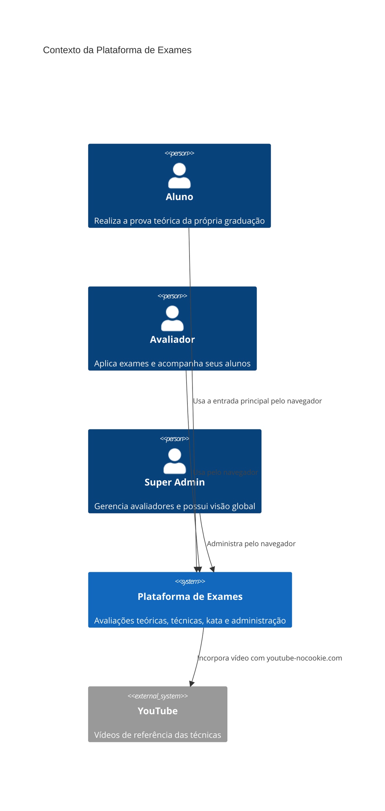
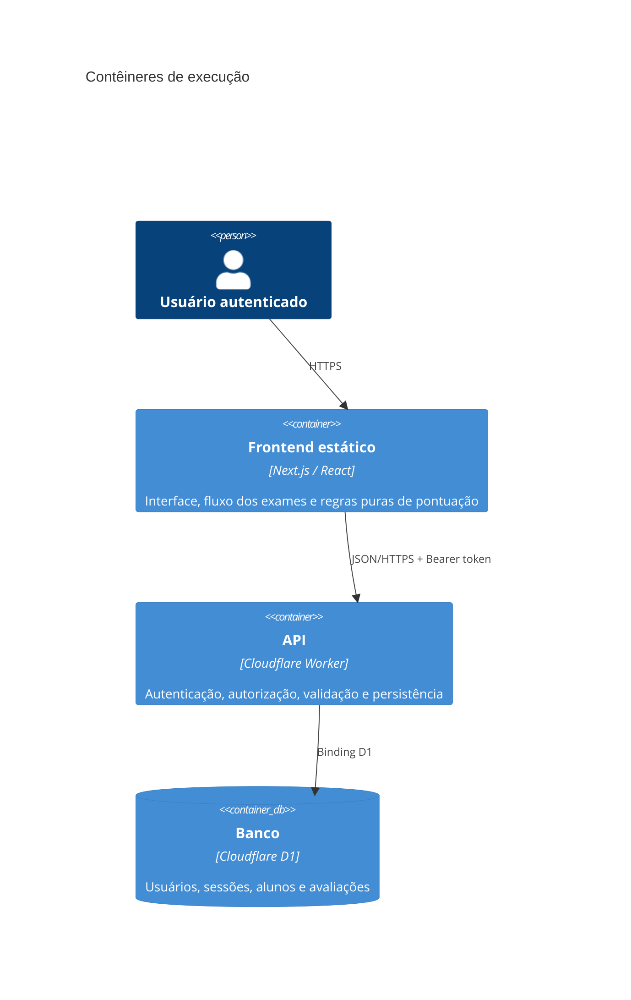
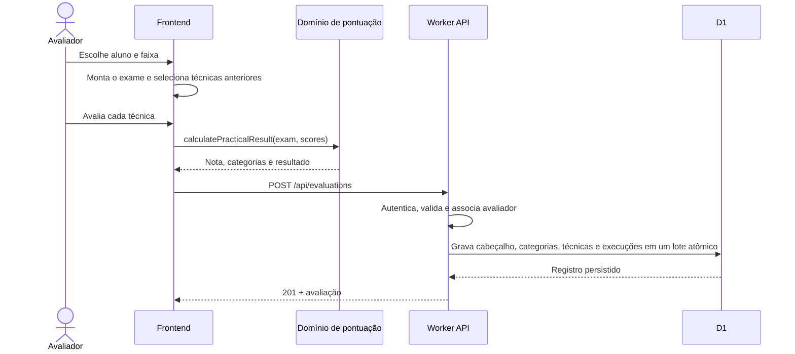
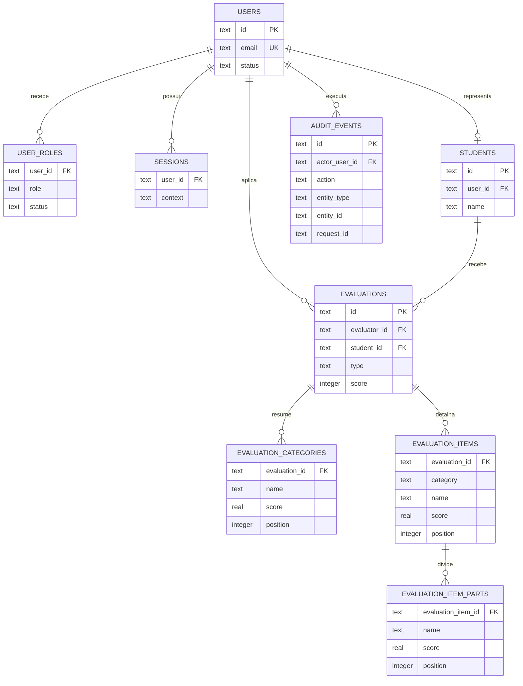

# Arquitetura da Plataforma de Exames de Judô

Este documento apresenta a visão técnica atual do sistema. As decisões que
explicam por que a arquitetura chegou a este formato estão no
[índice de ADRs](adr/README.md); os procedimentos operacionais ficam no
[runbook](../operations/runbook.md). A próxima evolução está documentada como
[proposta de produto](../product/evolution-plan.md) e ainda depende de aprovação.

## Objetivos arquiteturais

- funcionar bem no celular durante um exame, inclusive em redes instáveis;
- manter frontend e API publicáveis de forma independente;
- preservar autoria, isolamento e histórico das avaliações por avaliador;
- concentrar regras de pontuação em funções puras, testáveis e sem dependência
  da interface;
- operar com baixo custo usando serviços gerenciados da Cloudflare;
- permitir evolução incremental sem introduzir um framework interno.

## Contexto e contêineres





## Limites de código

```text
app/                         composição da aplicação Next.js
components/                  apresentação e fluxos por área
  admin-*                    administração
  technical-exam.tsx         avaliação prática
  kata-exam.tsx              avaliação de kata
  student-auth-screen.tsx    entrada principal e cadastro do aluno
  student-portal.tsx         área teórica restrita ao contexto estudantil
lib/                         domínio executado no navegador e contratos da API
  practical-exams.ts         catálogo, seleção automática e vídeos
  practical-scoring.ts       regra de aprovação da prática
  kata-exams.ts              catálogo e pontuação de kata
  event-operations.ts        indicadores e bloqueios do dia de exame
backend/src/                 módulos do Worker
  index.ts                   composição e roteamento HTTP
  auth.ts                    casos de uso de autenticação e perfil
  student-auth.ts            cadastro e autenticação no contexto de aluno
  theory-admin.ts            versões, questões e publicação da prova teórica
  theory-domain.ts           validação pura do conteúdo teórico
  security.ts                senha, sessão e autenticação da requisição
  evaluations.ts             consultas e escrita de avaliações
  audit.ts                   gravação e consulta paginada da auditoria
  users.ts                   equipe e convites
  domain.ts                  validações e transformações puras
  http.ts                    respostas, CORS e autorização comum
  contracts.ts               tipos internos do backend
tests/                       regressões das regras de negócio
```

As dependências devem apontar da interface para `lib`, e do entrypoint do Worker
para os módulos de caso de uso. Arquivos de domínio não importam React, Next.js
ou componentes. Acesso a D1 acontece apenas no backend.

## Fluxo de uma avaliação prática



## Modelo de dados principal



## Invariantes

- o backend deriva o avaliador da sessão; o cliente não escolhe a autoria;
- a graduação do avaliador é definida pelo Super Admin e não se confunde com a
  graduação pretendida do judoca;
- um avaliador comum só consulta as próprias avaliações;
- apenas o Super Admin convida e gerencia usuários;
- somente o Super Admin consulta o histórico de auditoria, que não pode ser
  alterado pela interface;
- IDs de avaliações são idempotentes por avaliador;
- a nota persistida usa a escala inteira de 0 a 100; a interface exibe 0 a 10;
- kata não participa do indicador de aprovação de exames técnicos;
- erro grave de kata divide a nota geral por dois uma única vez;
- seleções automáticas não repetem uma técnica fixa na mesma categoria;
- o catálogo de técnicas e as regras de aprovação não são configuráveis pela interface;
- sequências de Renraku-Henka recebem uma única nota; apenas itens que pedem
  explicitamente múltiplas execuções guardam as notas das partes e sua média.

## Qualidade e observabilidade

`pnpm test` protege regras de aprovação, kata, seleção automática e agregações
administrativas. `pnpm typecheck`, `pnpm lint` e `pnpm build` são barreiras de
entrega. O Worker registra falhas em JSON e habilita logs e traces com amostragem
de 10% para traces.

## Riscos conhecidos

- o token de sessão fica no `localStorage` porque frontend e API são Workers
  separados; uma origem única permitiria migrar para cookie `HttpOnly`;
- nomes ainda funcionam como fallback de identidade para registros históricos;
- a fila offline preserva avaliações no aparelho, mas um item ainda não
  sincronizado depende daquele dispositivo até a confirmação do servidor;
- rate limiting de autenticação e política formal de retenção ainda são ações
  operacionais pendentes, separadas do estado de conclusão do software no
  [plano de evolução](../product/evolution-plan.md#ativações-externas-restantes).
