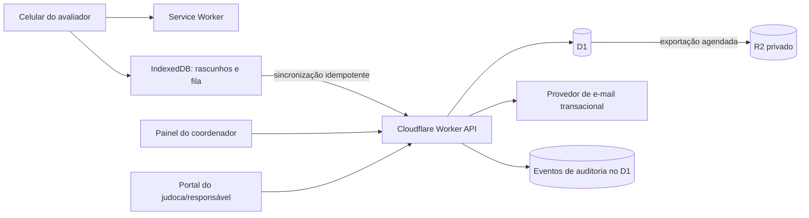
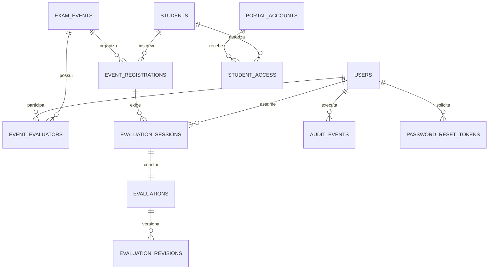

# Plano de evolução da plataforma

- Estado: aguardando aprovação
- Data da proposta: 2026-10-21
- Responsável pelo produto: Associação Judô Rogério Cruz
- Escopo: pontos 1, 2, 3, 5, 6, 7, 9, 10, 11, 14, 16, 17 e 18

## 1. Objetivo

> Atualização prioritária: antes das fases abaixo, será executada a
> [Fase 0 — exame teórico dentro da plataforma](theoretical-exam-plan.md).
> Ela cria a identidade do aluno e passa a definir a graduação autorizada para
> a avaliação prática. A base offline da Fase 1 continua em execução porque
> será reutilizada pelo novo fluxo teórico.

Transformar a plataforma em uma ferramenta confiável para operar um dia de
exame com vários avaliadores e celulares, sem perder a simplicidade atual. O
sistema deve continuar útil fora do evento: acompanhar a evolução técnica,
entregar devolutivas aos judocas e manter um histórico auditável.

As prioridades do produto são, nesta ordem:

1. não perder avaliações, mesmo com internet instável;
2. reduzir o tempo e a atenção necessários para lançar cada nota no celular;
3. coordenar vários avaliadores no mesmo evento sem duplicidade;
4. transformar as notas armazenadas em informação útil;
5. dar acesso seguro ao judoca ou responsável;
6. manter recuperação, auditoria e backup compatíveis com dados pessoais.

### Rastreabilidade do pedido

| Ponto aprovado | Tratamento no plano |
| --- | --- |
| 1. Salvamento automático/offline | Fase 1, rascunhos e fila IndexedDB |
| 2. Evolução | Fase 3, histórico e gráficos comparáveis |
| 3. PDF | Fase 3, somente sob demanda no histórico ou portal |
| 5. Confirmação de salvamento | Fase 1, máquina de estados visível |
| 6. Dificuldades técnicas | Fase 3, análises por faixa, categoria e técnica |
| 7. Filtros | Fase 3, filtros combináveis e paginação |
| 9. Correções | Fase 4, revisões imutáveis com motivo |
| 10. Dia de exame | Fase 2, evento, fila, estações e vários avaliadores |
| 11. Modo rápido | Fase 2, fluxo principal de um toque |
| 14. Portal | Fase 5, acesso somente leitura e vínculo com responsável |
| 16. Backup | Fase 4, Time Travel e exportações privadas no R2 |
| 17. Recuperação de senha | Fase 4, token único e e-mail transacional |
| 18. Auditoria | Base na fase 1, concluída na fase 4 |

## 2. Princípios

- **Mobile-first real:** todas as ações frequentes funcionam com uma mão e têm
  área de toque mínima de 44 × 44 px.
- **Exame antes da administração:** durante uma prova, a interface elimina
  distrações e mantém nome, graduação, categoria e estado de sincronização
  sempre visíveis.
- **Offline explícito:** o sistema nunca finge que uma informação chegou ao
  servidor. Cada registro mostra `salvo neste aparelho`, `sincronizando`,
  `salvo no servidor` ou `requer atenção`.
- **Histórico em vez de sobrescrita:** correções não apagam o que aconteceu.
- **Privacidade por padrão:** o portal do judoca expõe somente o histórico da
  pessoa vinculada e coleta o mínimo de dados necessário.
- **Sem competição indevida:** indicadores servem para orientar treino; não
  haverá ranking público de alunos ou avaliadores.
- **Custo proporcional ao uso:** D1 continua como banco principal. R2 e e-mail
  entram apenas nos casos em que resolvem backup e comunicação transacional.

## 3. Entregas por fase

| Fase | Resultado utilizável | Porte relativo | Depende de |
| --- | --- | --- | --- |
| 0 | Aluno faz o teórico na plataforma e obtém elegibilidade para a prática | Muito grande | Regras da prova e identidade |
| 1 | Avaliações resilientes e estado de salvamento confiável | Grande | Modelo detalhado atual |
| 2 | Evento com vários avaliadores e modo rápido | Muito grande | Fase 1 |
| 3 | Evolução, análises, filtros e PDF sob demanda | Grande | Dados completos e versionados |
| 4 | Correção, auditoria, backup e recuperação de senha | Grande | Base de auditoria da fase 1 |
| 5 | Portal seguro do judoca ou responsável | Muito grande | Fases 3 e 4 |

Os portes comparam os blocos entre si; não são estimativas de calendário. Cada
fase deve ser dividida em entregas pequenas e publicáveis depois da aprovação.

### Fase 1 — Confiabilidade operacional

Inclui os pontos 1, 5 e a base dos pontos 16 e 18.

#### 1.1 Rascunho automático e modo offline

- transformar o frontend em uma PWA instalável;
- armazenar o exame em andamento no IndexedDB a cada alteração;
- permitir continuar uma avaliação iniciada no mesmo aparelho sem rede;
- manter uma fila local de avaliações concluídas ainda não sincronizadas;
- reutilizar o `id` gerado no aparelho como chave idempotente no servidor;
- repetir a sincronização com espera progressiva, sem duplicar avaliações;
- remover do aparelho o conteúdo sincronizado após o período de segurança;
- permitir descartar manualmente somente um rascunho não enviado, com
  confirmação clara;
- impedir logout silencioso quando existirem registros pendentes.

Estados obrigatórios:

| Estado | Significado | Ação disponível |
| --- | --- | --- |
| Salvo neste aparelho | Está seguro localmente, mas não chegou ao servidor | Sincronizar |
| Sincronizando | Envio em andamento | Aguardar |
| Salvo no servidor | API confirmou o registro completo | Abrir relatório |
| Requer atenção | Falha que não foi resolvida automaticamente | Tentar novamente |

Restrições:

- o primeiro login exige internet;
- somente sessões previamente autenticadas podem abrir dados offline;
- dados locais são isolados por usuário e removidos no logout depois da
  confirmação de sincronização;
- o cache da aplicação não inclui respostas administrativas sensíveis.

#### 1.2 Confirmação de persistência

- a tela final deixa de assumir sucesso antes da resposta da API;
- o resultado aparece imediatamente, mas o estado do salvamento permanece
  visível;
- erros mantêm a avaliação na fila local;
- o servidor grava cabeçalho, categorias, técnicas, partes e auditoria em uma
  única operação atômica.

#### 1.3 Base de auditoria

Criar `audit_events` desde esta fase para registrar sincronização, criação,
correção, exclusão lógica, restauração e ações administrativas. O conteúdo do
evento deve evitar senha, token, hash ou cópia desnecessária de dados pessoais.

#### Critérios de aceite da fase 1

- uma avaliação completa sobrevive a recarregar ou fechar o navegador;
- concluir duas vezes o mesmo registro não cria duplicatas;
- o avaliador identifica visualmente se o dado está local ou no servidor;
- uma queda de rede durante o exame não bloqueia a próxima técnica;
- ao recuperar a rede, os itens pendentes são sincronizados;
- sincronização e falhas possuem testes automatizados;
- 360 px, 768 px, 1280 px, tema claro, tema escuro, teclado e movimento reduzido
  são verificados.

### Fase 2 — Dia de exame e avaliação rápida

Inclui os pontos 10 e 11, considerados centrais.

**Estado: em execução.** O modelo de eventos, participantes, inscrições,
modalidades e ciclo de vida já está disponível na API. A fila operacional já
permite assumir uma tarefa de forma atômica, abrir a prova técnica ou de kata
diretamente e preservar o vínculo no rascunho offline e na avaliação
sincronizada. O primeiro incremento do modo rápido também já oferece avanço
automático para a próxima técnica e desfazer o último lançamento. Os
fila ao vivo recebe atualização periódica e filtros por situação, modalidade e
responsável. Indicadores de duração e pendências por dispositivo seguem como
marco independente.

#### 2.1 Evento de exame com vários avaliadores

Um Super Admin cria o evento e cadastra:

- nome, data, local e observações operacionais;
- judocas inscritos e graduação pretendida;
- modalidades exigidas para cada inscrição;
- avaliadores participantes;
- estações opcionais, como `Tatame 1`, `Tatame 2` ou `Kata`.

Estados do evento:

```text
Rascunho → Aberto → Em andamento → Encerrado → Arquivado
```

Estados do judoca no evento:

```text
Aguardando → Chamado → Em avaliação → Pendente de sincronização → Concluído
```

Modelo inicial recomendado:

- vários avaliadores participam do evento;
- cada avaliação em andamento tem um avaliador responsável;
- o avaliador pode assumir um judoca livre ou receber uma atribuição;
- a tomada de responsabilidade é atômica para impedir dois celulares de
  iniciarem a mesma modalidade por engano;
- sem rede, o avaliador só pode iniciar sessões previamente atribuídas e
  armazenadas em seu aparelho; assumir itens da fila compartilhada exige rede;
- o coordenador pode liberar ou reatribuir uma avaliação abandonada;
- todos os avaliadores veem somente a fila operacional necessária; o Super
  Admin acompanha o evento inteiro.

Não entra nesta versão: banca em que vários avaliadores atribuem notas
independentes ao mesmo judoca e o sistema calcula uma média. Essa necessidade
deve ser aprovada separadamente porque altera as regras de pontuação.

#### 2.2 Painel ao vivo do evento

O coordenador visualiza:

- inscritos, presentes, em avaliação, pendentes e concluídos;
- avaliador e estação responsáveis por cada avaliação;
- dispositivos com sincronização pendente;
- possíveis duplicidades;
- tempo médio por avaliação;
- filtros por faixa, estação, avaliador e estado.

Atualização por consulta periódica é suficiente para a escala prevista. Não se
introduz infraestrutura em tempo real até existir uma necessidade comprovada.

#### 2.3 Modo rápido no celular

O modo rápido mantém o padrão de cards, mas reduz interações:

```text
┌────────────────────────────────┐
│ Ana Silva · Faixa Verde   salvo│
│ Nage Waza              62%     │
├────────────────────────────────┤
│ Uchi-mata                      │
│ [10 Ótimo] [7 Bom]             │
│ [ 5 Ruim ] [0 Insuficiente]    │
├────────────────────────────────┤
│ Próxima: Kata-guruma           │
│ [Desfazer]        [Observação] │
└────────────────────────────────┘
```

- uma técnica por vez, mantendo a próxima visível como contexto;
- quatro notas grandes, com texto e cor, nunca apenas cor;
- ao tocar, salvar localmente e avançar sem nova confirmação;
- botão `Desfazer` persistente para a última ação;
- gesto lateral opcional, nunca obrigatório;
- vibração curta opcional em aparelhos compatíveis;
- observações rápidas e texto livre sem bloquear o fluxo;
- múltiplas execuções permanecem no mesmo card;
- barra de progresso sem exibir uma contagem que desestimule;
- troca rápida entre categorias sem abrir menu lateral;
- aviso antes de sair caso exista algo pendente.

#### Critérios de aceite da fase 2

- um evento aceita vários avaliadores simultaneamente;
- o mesmo exame não pode ser assumido por dois avaliadores;
- uma atribuição abandonada pode ser liberada pelo coordenador;
- o fluxo principal exige um toque por técnica após o card estar em foco;
- desfazer restaura nota, média e rascunho local;
- o painel diferencia concluído no servidor de concluído apenas no aparelho;
- o encerramento do evento lista pendências antes de confirmar.

### Fase 3 — Relatórios e inteligência técnica

Inclui os pontos 2, 3, 6 e 7.

**Estado: em execução.** A área de notas já possui filtros combináveis e um
primeiro painel de dificuldades com média por categoria, distribuição dos
critérios, técnicas com menor média e aviso para amostras pequenas. O perfil do
judoca já separa séries pela modalidade, graduação e matriz e compara nota
geral, categorias e dificuldades recorrentes entre exames compatíveis. A
impressão/PDF sob demanda já está disponível no relatório detalhado do histórico
e não aparece ao concluir a prova. O histórico individual também possui filtros
combináveis de modalidade, graduação e período.

#### 3.1 Evolução individual

No perfil do judoca:

- linha do tempo da nota final;
- gráfico por categoria ao longo dos exames;
- melhoras e regressões entre duas avaliações comparáveis;
- técnicas com dificuldade recorrente;
- histórico completo filtrável por graduação, modalidade e período;
- indicação quando dois exames usam catálogos diferentes.

O sistema não compara diretamente notas de modalidades ou matrizes
incompatíveis. Todo exame futuro deve guardar uma versão do catálogo e das
regras utilizadas.

#### 3.2 Painel de dificuldades técnicas

- média por categoria e graduação;
- distribuição entre Ótimo, Bom, Ruim e Insuficiente;
- técnicas com menor média;
- reincidência por judoca;
- percentual de aprovação e reexame por período;
- tamanho da amostra sempre visível;
- filtros por evento, graduação, categoria, técnica, avaliador, resultado e
  intervalo de datas.

Indicadores com amostra pequena devem receber aviso e não devem ser usados como
ranking de desempenho profissional do avaliador.

#### 3.3 PDF sob demanda

O PDF não aparece nem é gerado automaticamente ao concluir a prova. Ele fica
disponível no histórico e no portal do judoca, mediante a ação `Gerar relatório`.

Conteúdo:

- identidade visual da associação;
- judoca, graduação, data, evento e avaliador;
- nota final e resultado;
- médias por categoria;
- todas as técnicas e notas;
- partes de técnicas com múltiplas execuções;
- observações e pontos de desenvolvimento;
- identificação da versão do exame;
- código de verificação do relatório, sem expor um link público permanente.

A primeira versão usa uma página HTML própria para impressão e o recurso
`Salvar como PDF` do navegador. Isso evita armazenar cópias binárias e mantém o
custo baixo. PDF assinado e arquivado no R2 fica fora do escopo inicial.

#### Critérios de aceite da fase 3

- filtros podem ser combinados e limpos sem recarregar a página;
- gráficos possuem alternativa textual acessível;
- relatórios deixam claro período e tamanho da amostra;
- o PDF reproduz todos os dados persistidos da avaliação;
- gerar ou imprimir relatório não modifica a avaliação;
- nenhum PDF é aberto automaticamente ao terminar um exame.

### Fase 4 — Governança, correções e recuperação

Inclui os pontos 9, 16, 17 e 18.

**Estado: em execução.** A exclusão de avaliações já é lógica, exige motivo,
remove o registro das consultas operacionais, preserva todo o detalhamento e
gera eventos de auditoria. O Super Admin possui uma área própria para consultar
e restaurar esses registros. Revisões de nota, backup e recuperação de senha
seguem como marcos independentes.

#### 4.1 Correção auditável

- avaliações deixam de ser sobrescritas;
- corrigir cria uma nova revisão ligada à anterior;
- motivo é obrigatório;
- o relatório mostra a revisão vigente e indica que houve correção;
- Super Admin vê a linha do tempo completa;
- exclusão na interface passa a ser lógica e reversível;
- remoção física ocorre apenas pela política de retenção e com registro.

Regra inicial proposta: avaliador corrige avaliações próprias por até 24 horas;
Super Admin corrige ou restaura a qualquer momento, sempre com motivo. Esse
prazo precisa de aprovação do cliente.

#### 4.2 Backup e restauração

Camadas propostas:

1. recuperação nativa por ponto no tempo do D1;
2. exportação lógica automática para bucket privado no R2;
3. retenção diária e mensal definida pela associação;
4. checksum, criptografia gerenciada pela plataforma e acesso mínimo;
5. teste trimestral de restauração em ambiente separado;
6. runbook com responsáveis, tempo esperado e validações pós-restauração.

Retenção inicial sugerida: 30 cópias diárias e 12 cópias mensais. A política
final depende da definição de retenção dos dados dos judocas.

#### 4.3 Recuperação de senha

- resposta idêntica para e-mail existente ou inexistente;
- token aleatório, de uso único, armazenado somente como hash;
- expiração sugerida de 20 minutos;
- invalidação das sessões anteriores após a troca;
- limites por IP e por conta;
- auditoria de solicitação e conclusão, sem guardar o token;
- e-mail transacional com versão texto e HTML;
- remetente em domínio autenticado da associação.

O backend usa uma interface de provedor. Para preservar a operação sem gastos,
a referência inicial é a API transacional da Brevo, cuja franquia gratuita na
data desta proposta é suficiente para o volume esperado. A chave fica em um
secret do Worker. Cloudflare Email Sending permanece como alternativa caso a
conta migre para Workers Paid. A escolha deve ser reconfirmada antes da
implementação, pois preços e limites externos mudam.

#### Critérios de aceite da fase 4

- toda correção mostra autor, data, motivo e valores anterior e novo;
- exclusões administrativas podem ser restauradas;
- o runbook restaura uma cópia em ambiente isolado com sucesso;
- solicitar recuperação não revela se o e-mail possui conta;
- tokens expirados, repetidos ou já usados são recusados;
- alterações sensíveis aparecem no histórico de auditoria.

### Fase 5 — Portal do judoca ou responsável

Inclui o ponto 14.

#### 5.1 Escopo do portal

- visão somente leitura;
- histórico de exames liberados pela associação;
- evolução por categoria;
- relatório detalhado e PDF sob demanda;
- técnicas prioritárias para treino;
- referências de vídeo já cadastradas;
- possibilidade de solicitar correção de dados, sem editar notas.

#### 5.2 Identidade e privacidade

O cadastro atual contém apenas o nome do judoca. Antes do portal será
necessário adicionar vínculo explícito entre estudante e identidade de acesso.

Modelo recomendado:

- adulto: conta própria com e-mail verificado;
- menor: conta do responsável, capaz de possuir vínculo com mais de um judoca;
- vínculo criado pelo Super Admin e aceito por convite;
- acesso revogável;
- página sem listagem ou busca de outros alunos;
- logs de acesso e download;
- política de retenção e canal para correção ou exclusão de dados.

Links públicos permanentes e QR Codes que dão acesso direto ao histórico não
são recomendados. Um QR Code pode apontar para a tela de login ou conter um
convite curto, revogável e de uso único.

#### Critérios de aceite da fase 5

- uma conta acessa somente judocas explicitamente vinculados;
- responsável com dois dependentes alterna entre eles sem misturar dados;
- convite expira, é de uso único e pode ser revogado;
- o portal funciona a partir de 320 px e não expõe funções administrativas;
- relatório ainda não liberado não aparece para o judoca;
- acessos e downloads ficam auditados.

## 4. Arquitetura alvo



Não se propõe Durable Objects na primeira versão. Para aproximadamente 50
usuários, operações condicionais no D1 e atualização periódica do painel são
mais simples. A decisão deve ser revista somente se houver colaboração
simultânea sobre o mesmo exame ou requisito real de atualização instantânea.

## 5. Modelo de dados proposto



Principais novas tabelas:

| Tabela | Responsabilidade |
| --- | --- |
| `exam_events` | Evento, local, datas e estado |
| `event_evaluators` | Participantes, papel e estação |
| `event_registrations` | Judocas, graduação e estado operacional |
| `evaluation_sessions` | Responsável, modalidade, rascunho remoto e trava lógica |
| `evaluation_revisions` | Versões imutáveis de uma avaliação corrigida |
| `audit_events` | Ações relevantes e metadados mínimos |
| `password_reset_tokens` | Hash, expiração e consumo de tokens |
| `portal_accounts` | Identidade de judoca ou responsável |
| `student_access` | Vínculos revogáveis entre conta e judoca |

Toda migração será aditiva. Exclusões físicas ou alterações destrutivas não
entram no mesmo deploy que cria o novo modelo.

## 6. Contratos de API planejados

Os caminhos podem ser refinados, mas as responsabilidades não devem se misturar.

| Método | Rota | Objetivo |
| --- | --- | --- |
| `POST` | `/api/evaluations/sync` | Sincronizar uma avaliação idempotente |
| `GET` | `/api/sync/status` | Consultar pendências conhecidas pelo servidor |
| `GET/POST` | `/api/events` | Listar ou criar eventos |
| `GET/PATCH` | `/api/events/:id` | Consultar ou alterar estado do evento |
| `POST` | `/api/events/:id/evaluators` | Vincular avaliadores |
| `POST` | `/api/events/:id/registrations` | Inscrever judocas |
| `POST` | `/api/evaluation-sessions/:id/claim` | Assumir avaliação de forma atômica |
| `POST` | `/api/evaluation-sessions/:id/release` | Liberar uma atribuição |
| `POST` | `/api/evaluations/:id/revisions` | Corrigir com motivo obrigatório |
| `POST` | `/api/evaluations/:id/archive` | Exclusão lógica |
| `POST` | `/api/evaluations/:id/restore` | Restaurar avaliação arquivada |
| `GET` | `/api/reports/technical` | Dados agregados e filtros |
| `GET` | `/api/evaluations/:id/print` | Dados autorizados para impressão |
| `POST` | `/api/auth/password-reset/request` | Solicitar recuperação |
| `POST` | `/api/auth/password-reset/confirm` | Trocar senha com token |
| `GET` | `/api/portal/students` | Dependentes acessíveis pela conta |
| `GET` | `/api/portal/students/:id` | Histórico liberado do judoca |

Requisitos transversais:

- autorização no backend para todas as rotas;
- paginação para listas;
- validação de entrada e limites de tamanho;
- `requestId` nos logs e respostas de erro;
- chave de idempotência nas mutações offline;
- data do servidor como autoridade para auditoria;
- nenhuma resposta inclui hash, token ou dado de outro aluno.

## 7. Estratégia de UX

A identidade visual deve remeter à súmula, ao tatame e à sinalização do judô,
sem virar uma coleção de cards genéricos. A informação em uso recebe contraste;
o restante permanece quieto.

- **Cor:** continuar usando as cores configuráveis existentes; estados de
  sincronização usam tokens semânticos próprios e equivalentes no tema escuro.
- **Tipografia:** manter a família atual para não descaracterizar o produto;
  números de nota usam a fonte condensada já presente.
- **Layout:** celular em uma coluna; tablet pode mostrar fila e avaliação lado a
  lado; desktop reserva largura para contexto e filtros, sem esticar a ficha.
- **Movimento:** apenas confirmação de nota, sincronização e mudança de estado;
  tudo respeita `prefers-reduced-motion`.
- **Acessibilidade:** texto acompanha cor e ícone; foco visível; gráficos têm
  tabela ou resumo textual equivalente.

## 8. Testes e qualidade

Cada fase exige:

- testes unitários das regras de domínio;
- testes de integração com D1 local;
- testes de contrato das permissões;
- testes ponta a ponta dos fluxos críticos;
- teste offline → online e duplicidade de sincronização;
- teste concorrente para dois avaliadores tentando assumir o mesmo exame;
- teste de impressão em A4;
- auditoria de acessibilidade;
- validação manual em 360 px, 768 px e 1280 px, claro e escuro;
- `pnpm test`, `pnpm lint`, `pnpm typecheck` e `pnpm build` no CI.

## 9. Implantação segura

Cada fase usa feature flag e migrações compatíveis com a versão anterior:

1. publicar schema aditivo;
2. publicar backend capaz de ler formato antigo e novo;
3. publicar frontend com a funcionalidade inicialmente desativada;
4. ativar para Super Admin e evento de teste;
5. validar métricas, logs e suporte offline;
6. ampliar para avaliadores;
7. remover compatibilidade antiga apenas em entrega posterior.

Antes do primeiro evento real, realizar um ensaio com pelo menos três aparelhos,
duas redes e dois avaliadores trabalhando simultaneamente.

### Marcos sugeridos de versionamento

Cada linha representa um commit ou uma sequência pequena de commits que deve
ficar verde isoladamente:

| Marco | Mensagem-base |
| --- | --- |
| Persistência local | `feat(offline): persistir rascunhos de avaliações` |
| Caixa de saída | `feat(sync): sincronizar avaliações de forma idempotente` |
| Estado de salvamento | `feat(exams): exibir confirmação real de persistência` |
| Eventos | `feat(events): estruturar eventos e inscrições` |
| Vários avaliadores | `feat(events): coordenar atribuições de avaliadores` |
| Modo rápido | `feat(exams): adicionar fluxo rápido de avaliação` |
| Evolução e filtros | `feat(reports): consolidar evolução e dificuldades` |
| Impressão | `feat(reports): gerar relatório imprimível sob demanda` |
| Revisões | `feat(audit): versionar correções de avaliações` |
| Backup | `feat(backup): exportar copias verificáveis do d1` |
| Recuperação | `feat(auth): adicionar recuperação segura de senha` |
| Portal | `feat(portal): liberar histórico ao judoca ou responsável` |

Migração, backend compatível, frontend e ativação da feature flag não devem ser
misturados em um único commit quando puderem ser implantados separadamente.

## 10. Itens explicitamente fora do escopo

- alterar o catálogo oficial de técnicas pela administração;
- ranking público de judocas ou avaliadores;
- geração automática de PDF ao concluir a prova;
- link público permanente para dados do aluno;
- banca com média de notas de vários avaliadores;
- notificações de marketing;
- aplicativo nativo para Android ou iOS;
- tempo real com WebSocket sem necessidade comprovada.

## 11. Decisões para aprovação

As recomendações abaixo podem ser aprovadas junto com o plano ou alteradas
antes da implementação:

| Tema | Recomendação | Decisão do cliente |
| --- | --- | --- |
| Distribuição no evento | Avaliador assume ou recebe um judoca; somente um responsável por modalidade | Pendente |
| Correção pelo avaliador | Permitida nas próprias avaliações por 24 horas | Pendente |
| Exclusão | Lógica e reversível; remoção física somente por retenção | Pendente |
| PDF | Gerado sob demanda no histórico/portal via impressão | Confirmado no pedido |
| Portal de menor | Acesso por conta verificada do responsável | Pendente |
| Liberação do relatório | Super Admin define quando o aluno pode visualizar | Pendente |
| Backups no R2 | 30 diários e 12 mensais | Pendente |
| Provedor de e-mail | Brevo gratuito, isolado por `EmailProvider` | Pendente |
| Eventos encerrados | Somente leitura; reabertura exclusiva do Super Admin | Pendente |
| Vibração no modo rápido | Opcional e desativável | Pendente |

## 12. Definição de pronto do programa

O conjunto estará concluído quando:

- um evento completo puder ocorrer com internet intermitente sem perda de nota;
- múltiplos avaliadores trabalhem sem iniciar o mesmo exame por engano;
- toda avaliação tenha autoria, versão, auditoria e estado de sincronização;
- professores encontrem dificuldades por aluno, faixa, categoria e técnica;
- PDF seja obtido sob demanda sem interromper o fluxo do exame;
- correções preservem valores anteriores;
- backups sejam restaurados em teste documentado;
- recuperação de senha funcione sem revelar contas;
- judoca ou responsável acesse somente os dados explicitamente vinculados.

## 13. Referências de infraestrutura

- [Cloudflare D1 — Time Travel e backups](https://developers.cloudflare.com/d1/reference/time-travel/)
- [Cloudflare Workflows — exportar D1 para R2](https://developers.cloudflare.com/workflows/examples/backup-d1/)
- [Cloudflare Email Service — enviar por Worker](https://developers.cloudflare.com/email-service/get-started/send-emails/)
- [Cloudflare Email Service — preços](https://developers.cloudflare.com/email-service/platform/pricing/)
- [Cloudflare Email Service — bindings e restrições](https://developers.cloudflare.com/email-service/configuration/send-bindings/)
- [Cloudflare R2](https://developers.cloudflare.com/r2/)
- [Cloudflare R2 — preços](https://developers.cloudflare.com/r2/pricing/)
- [Cloudflare Workflows — preços](https://developers.cloudflare.com/workflows/reference/pricing/)
- [Brevo — planos e franquia gratuita](https://help.brevo.com/hc/en-us/articles/208589409-About-Brevo-s-pricing-plans)

Os limites, disponibilidade e preços desses serviços devem ser conferidos
novamente no início de cada fase; não fazem parte da aprovação funcional.

## 14. Envelope de custo

O desenho busca custo mensal zero no volume atual, mas não promete gratuidade
eterna de serviços externos.

| Capacidade | Estratégia de baixo custo | Proteção |
| --- | --- | --- |
| Aplicação e API | Workers já existentes | acompanhar uso no painel |
| Dados | D1 já existente | paginação e consultas indexadas |
| Offline | IndexedDB no aparelho | expiração e limpeza por usuário |
| PDF | impressão no navegador | não armazenar binário inicialmente |
| Backup | uma execução diária de Workflow e bucket R2 pequeno | alerta de uso e retenção automática |
| E-mail | franquia transacional gratuita da Brevo | limite por conta/IP e alerta de falha |

Antes de habilitar R2, Workflows ou e-mail, registrar limites vigentes, configurar
alertas disponíveis e definir o que o sistema fará ao atingir uma franquia. Uma
mudança que possa gerar cobrança exige aprovação separada.

